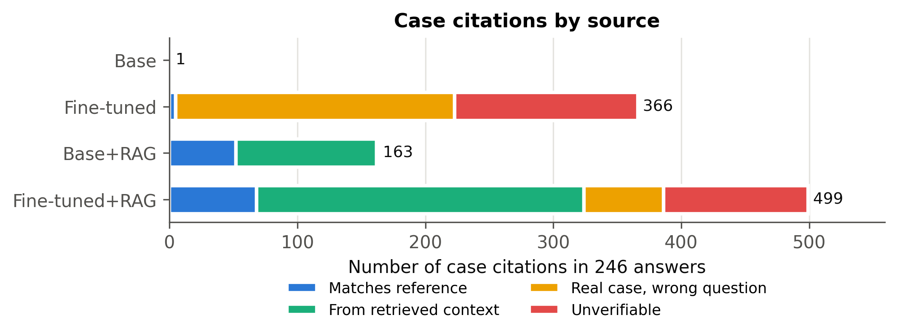

# pakistan-cpc-legal-llm

Fine-tuning, retrieval-augmented generation and citation hallucination analysis for legal QA on Pakistan's Code of Civil Procedure 1908 (Qwen2.5-7B, QLoRA, RAG).

Code for the paper **"CPC-PKL: Fine-Tuning, Retrieval, and Citation Hallucination in Legal Question Answering on Pakistan's Code of Civil Procedure"** (Atif Ullah Khan, 2026).

[Paper](LINK_TO_ARXIV_OR_ZENODO) · [Fine-tuned adapter on Hugging Face](LINK_TO_HUGGING_FACE)

> **Not legal advice.** This is a research project. The models can produce confident but incorrect legal statements and case citations. Do not use them to prepare court filings.

---

## Overview

We study how well large language models answer questions about Pakistan's **Code of Civil Procedure 1908 (CPC)**, and whether the case law they cite is real.

- **Dataset (CPC-PKL):** 2,467 long-form question-answer pairs about the CPC in 5 reasoning categories (Definitional, Procedural, Scenario, Comparative, Consequence).
- **Systems compared** (all based on **Qwen2.5-7B-Instruct**): base model, QLoRA fine-tuned model, base + RAG, fine-tuned + RAG.
- **Evaluation:** ROUGE, BERTScore, statutory provision recall, and the **provenance of every case citation** (matches reference, from retrieved context, from another training answer, or unverifiable).
- **Dataset audit:** every citation in the LLM-generated dataset is checked against the source text.

## Key results

Results on 246 held-out test questions.

| System | ROUGE-L | BERTScore-F1 | Provisions found (not named in question) | Grounded citations | Unverifiable citations |
|---|---|---|---|---|---|
| Base | 0.234 | 0.841 | 3.0% | n/a (1 citation) | n/a |
| Fine-tuned | 0.266 | 0.862 | 8.8% | 1.4% | 39.1% |
| Base + RAG | 0.265 | 0.857 | 18.6% | **99.4%** | **0.6%** |
| Fine-tuned + RAG | **0.278** | **0.864** | **23.8%** | 64.9% | 22.6% |

- **Fine-tuning improves answer quality** (all differences significant, paired Wilcoxon test) **but teaches the model to cite cases it cannot ground.** Only 1.4% of its citations match the reference answer.
- **Retrieval grounds most citations.** It raises the fine-tuned model's grounded citations from 1.4% to 64.9% and gives the best answer quality.
- **The generated dataset contains fabricated citations.** 21.8% of citation mentions in the dataset do not appear anywhere in the source text, even under lenient matching (`results/citation_audit/`).

<p align="center"></p>

## Repository structure

```
pakistan-cpc-legal-llm/
├── README.md
├── LICENSE                         # MIT (code)
├── requirements.txt
├── notebooks/
│   └── CPC_PKL_full_run.ipynb      # the complete run on Kaggle (2x T4), with outputs
├── src/
│   ├── split_data.py               # stratified 80/10/10 split (seed 42)
│   ├── train.py                    # QLoRA fine-tuning, DDP on 2 GPUs
│   ├── generate.py                 # answers from base / fine-tuned model
│   ├── build_retrieval_index.py    # hybrid BGE + BM25 retrieval
│   ├── generate_rag.py             # answers with retrieved context
│   ├── evaluate.py                 # all metrics for the 4 systems
│   └── make_figures.py             # paper figures
├── audit/
│   └── citation_audit.py           # checks dataset citations against the source text
├── results/
│   ├── eval_final/                 # main results: 4 systems, per category, significance, examples
│   ├── eval_clean/                 # base vs fine-tuned evaluation (before RAG)
│   ├── citation_audit/             # audit summary + list of citations absent from the source
│   ├── predictions/                # generated answers of all 4 systems (test set)
│   ├── rag/retrieved.jsonl         # retrieved knowledge-base entries per test question
│   ├── training/                   # training log, loss history, LoRA config
│   └── logs/                       # generation logs
├── figures/                        # all paper figures (PNG + PDF)
└── data/
    └── README.md                   # how to obtain the data (not included)
```

## Setup

Tested on Kaggle with Python 3.13 and 2x NVIDIA T4 (16 GB each).

```bash
pip install -r requirements.txt
```

## Reproducing the results

The easiest way is to run `notebooks/CPC_PKL_full_run.ipynb` on Kaggle with **GPU T4 x2** and **Internet ON**, adding the dataset as input.

The same steps as scripts (paths assume the Kaggle layout `/kaggle/working`; edit them for a local run):

```bash
python src/split_data.py                                  # 1,975 / 246 / 246
torchrun --nproc_per_node=2 src/train.py                  # ~2.2 h on 2x T4
torchrun --nproc_per_node=2 src/generate.py base
torchrun --nproc_per_node=2 src/generate.py ft
python src/build_retrieval_index.py                       # train+val only, no test leakage
torchrun --nproc_per_node=2 src/generate_rag.py base_rag
torchrun --nproc_per_node=2 src/generate_rag.py ft_rag
python src/evaluate.py
python src/make_figures.py
```

### Main hyperparameters

| Setting | Value |
|---|---|
| Base model | Qwen2.5-7B-Instruct, 4-bit NF4, fp16 compute |
| LoRA | r = 16, alpha = 32, dropout = 0.05, all attention and MLP projections |
| Trainable parameters | 40.4M (0.53%) |
| Optimizer | paged AdamW 8-bit, lr 2e-4, cosine schedule, 3% warm-up |
| Batch | 1 per GPU x 8 accumulation x 2 GPUs = 16 |
| Epochs | 3 (best validation loss after epoch 2: 1.314) |
| Max length | 2,048 tokens (loss on answer tokens only) |
| Decoding | greedy, repetition penalty 1.05, max 1,024 new tokens |
| Retrieval | top-3 passages, reciprocal rank fusion (k = 60), 350 words per passage |

## Citation audit

To check a QA dataset against your own copy of the source text:

```bash
python audit/citation_audit.py \
    --dataset data/final_legal_dataset.json \
    --corpus "path/to/corpus_txt_folder" \
    --out results/citation_audit
```

## Data

- **Source:** *Code of Civil Procedure 1908: Commentary* by Amir Raza A. Khan and Ibrahim Haroon, 19th edition. Pages 1 to 352 were extracted with PyMuPDF and pages 353 to 1,439 with Tesseract OCR.
- **QA generation:** question-answer pairs were generated by an LLM (Claude, Anthropic) from the extracted text, then merged and filtered.
- **Not included here:** the book is copyrighted, so the book, the corpus text and the dataset are not in this repository. See `data/README.md`.

## Citation

```bibtex
@misc{khan2026cpcpkl,
  title  = {CPC-PKL: Fine-Tuning, Retrieval, and Citation Hallucination in Legal
            Question Answering on Pakistan's Code of Civil Procedure},
  author = {Khan, Atif Ullah},
  year   = {2026},
  note   = {Preprint. LINK_TO_ARXIV_OR_ZENODO}
}
```

## License

Code: MIT License (see `LICENSE`). The fine-tuned adapter is released separately on Hugging Face under Apache 2.0, matching the base model.

## Acknowledgements

Experiments were run on free Kaggle GPUs. An AI assistant was used to help write parts of the code and documentation; all experiments were run and checked by the author.

## Contact

Atif Ullah Khan · aatifullahkhan16@gmail.com
